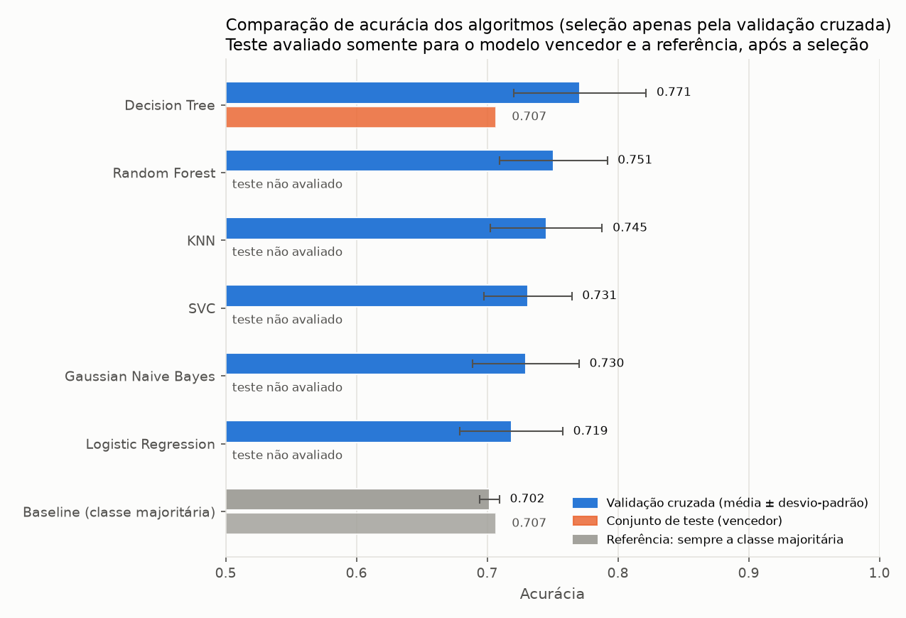
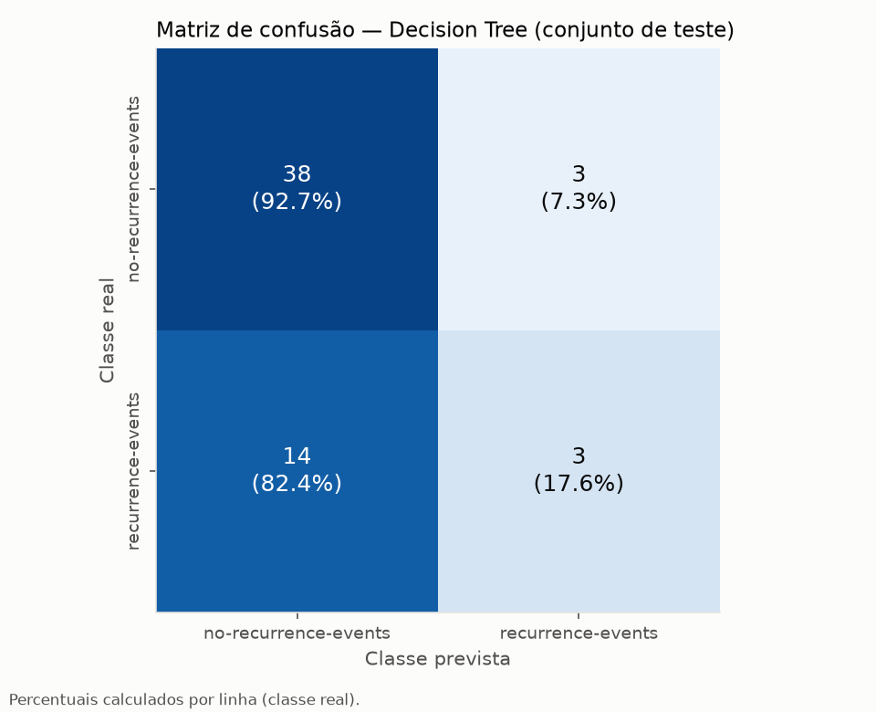
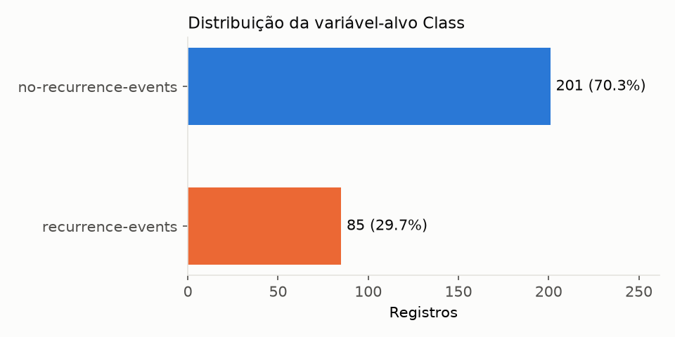
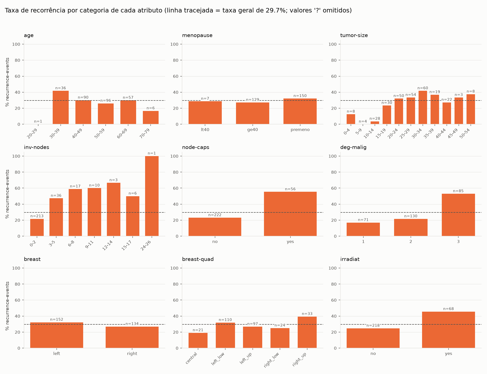

# Classificação de Recorrência do Câncer de Mama

Projeto da disciplina de Data Science. A partir da base *Breast Cancer* (UCI), treina um
classificador que indica se uma paciente tende a ter recorrência do câncer
(`recurrence-events`) ou não (`no-recurrence-events`), que é o atributo `Class`.

O projeto tem dois módulos, como pede o enunciado:

1. **Treinamento** (`src/training.py`): prepara os dados, compara seis algoritmos e salva o de
   melhor acurácia em `models/best_model.joblib`.
2. **Inferência** (`src/inference.py`): recebe os dados de uma nova paciente e devolve a classe
   prevista.

> Uso apenas educacional. A base é de 1988 e o resultado **não é diagnóstico médico**.

## Base de dados

- Fonte: <https://archive.ics.uci.edu/dataset/14/breast+cancer> (Zwitter & Soklic, 1988; licença CC BY 4.0)
- Arquivo: `data/breast-cancer.csv`, com 286 pacientes, 9 atributos e a classe
- Classes: 201 `no-recurrence-events` (70,3%) e 85 `recurrence-events` (29,7%)
- Valores desconhecidos (`?`): 8 em `node-caps` e 1 em `breast-quad`

Todos os atributos são categóricos, a maioria em faixas (por exemplo, `age = 40-49`).

| Atributo | Significado |
|---|---|
| `age` | faixa etária |
| `menopause` | status da menopausa (`premeno`, `lt40`, `ge40`) |
| `tumor-size` | tamanho do tumor em mm (faixa) |
| `inv-nodes` | linfonodos com metástase (faixa) |
| `node-caps` | tumor atravessou a cápsula do linfonodo (`yes`/`no`) |
| `deg-malig` | grau de malignidade (1, 2, 3) |
| `breast` | mama afetada (`left`/`right`) |
| `breast-quad` | quadrante afetado |
| `irradiat` | fez radioterapia (`yes`/`no`) |

## Etapas do treinamento

Segue o roteiro visto em aula (balancear, normalizar, hiperparametrizar, treinar, medir a
acurácia e salvar):

1. **Análise exploratória** (`src/exploratory_analysis.py`): distribuição das classes, valores
   `?`, duplicados e associação de cada atributo com a classe (teste qui-quadrado e V de Cramér).
   Como os dados são categóricos, média, desvio-padrão e Pearson não se aplicam.
2. **Separação treino/teste** estratificada: 80% treino (228) e 20% teste (58), `random_state=42`.
3. **Pré-processamento**: `?` vira valor ausente e é preenchido pela moda. Os atributos
   categóricos são transformados com `OneHotEncoder` (equivale ao `get_dummies`), e `deg-malig`
   fica numérico, com `MinMaxScaler` nos modelos sensíveis à escala.
4. **Balanceamento com SMOTE**: testado em todos os algoritmos, aplicado só no treino.
5. **Hiperparametrização** com `GridSearchCV` e `RandomizedSearchCV`, usando validação cruzada
   estratificada (5 partes, repetida 10 vezes).
6. **Algoritmos comparados**: Decision Tree, Random Forest, KNN, SVC, Gaussian Naive Bayes e
   Logistic Regression, além de uma referência que sempre responde a classe majoritária.
7. **Seleção** pela maior acurácia média na validação cruzada. Só o vencedor é avaliado no teste.
8. **Persistência**: pré-processamento e modelo são salvos juntos em `models/best_model.joblib`.

## Resultados

| Modelo | Acurácia (validação cruzada) | Acurácia (teste) |
|---|---|---|
| **Decision Tree** (escolhido) | **0,7708** | 0,7069 |
| Random Forest | 0,7506 | — |
| KNN | 0,7453 | — |
| SVC | 0,7312 | — |
| Gaussian Naive Bayes | 0,7295 | — |
| Logistic Regression | 0,7185 | — |
| Referência (classe majoritária) | 0,7018 | 0,7069 |

O modelo escolhido é uma árvore de decisão (`gini`, profundidade 2) **sem SMOTE**: o SMOTE
aumentou o recall da classe `recurrence-events`, mas reduziu a acurácia em todos os algoritmos.
Como o enunciado pede ênfase na acurácia, ficou de fora.

A árvore aprendeu uma regra simples: prevê recorrência quando `inv-nodes` é diferente de `0-2`
**e** `deg-malig = 3`. Esses são os dois atributos mais associados à recorrência na análise
exploratória.

Matriz de confusão no teste (58 pacientes):

| | previsto: não recorre | previsto: recorre |
|---|---|---|
| **real: não recorre** | 38 | 3 |
| **real: recorre** | 14 | 3 |

**Limitações**: no teste, a acurácia empatou com a referência que sempre responde "não recorre",
e o modelo identificou só 3 das 17 recorrências (recall 0,18). A base é pequena (286 registros),
os atributos são faixas grosseiras e há pacientes com atributos idênticos e classes diferentes, o
que limita qualquer algoritmo.

Gráficos gerados (todos também em `reports/png/`):






## LGPD

Dados de saúde são **dados pessoais sensíveis** (LGPD, art. 11). Esta base é pública e não tem
identificadores como nome ou CPF, apenas faixas de valores, o que reduz o risco de
reidentificação. Em uso real com pacientes, seria preciso base legal adequada, controle de
acesso e anonimização ou pseudonimização dos registros.

## Como rodar

Requer Python 3.12 ou superior. Execute os comandos na raiz do projeto.

```bash
python3 -m venv .venv
source .venv/bin/activate          # Windows: .venv\Scripts\activate
pip install -r requirements.txt
```

```bash
python -m src.exploratory_analysis   # análise exploratória
python -m src.training               # treinamento (alguns minutos)
python -m pytest                     # testes (67)
```

**Inferência** com um arquivo JSON:

```bash
python -m src.inference --json examples/nova_paciente.json
```

ou passando os atributos direto:

```bash
python -m src.inference --age 40-49 --menopause premeno --tumor-size 30-34 --inv-nodes 3-5 \
  --node-caps yes --deg-malig 3 --breast left --breast-quad left_low --irradiat yes
```

Saída para `examples/nova_paciente.json`:

```
Resultado da inferência
Classe prevista: no-recurrence-events
Probabilidades estimadas:
  * no-recurrence-events: 76.39%
  * recurrence-events: 23.61%
```

Os nove atributos são obrigatórios. Valores fora do domínio da UCI são rejeitados com mensagem de
erro, e `?` ou `null` são aceitos como valor desconhecido.

## Estrutura

```
data/breast-cancer.csv        base original
examples/nova_paciente.json   paciente de exemplo para a inferência
models/best_model.joblib      modelo treinado (pré-processamento + árvore)
reports/                      relatórios .txt/.csv/.json e gráficos .png
reports/png/                  todos os gráficos .png
src/config.py                 caminhos, semente e atributos
src/data.py                   leitura e validação da base
src/exploratory_analysis.py   análise exploratória
src/preprocessing.py          pré-processamento
src/training.py               módulo de treinamento
src/evaluation.py             métricas e gráficos
src/inference.py              módulo de inferência
tests/                        testes automatizados
```
